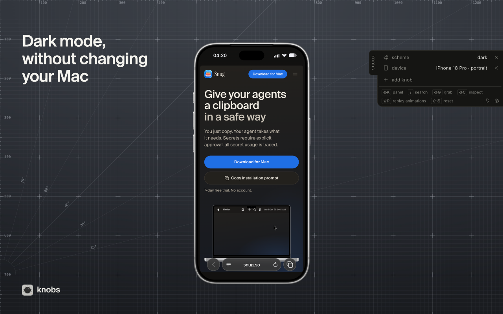
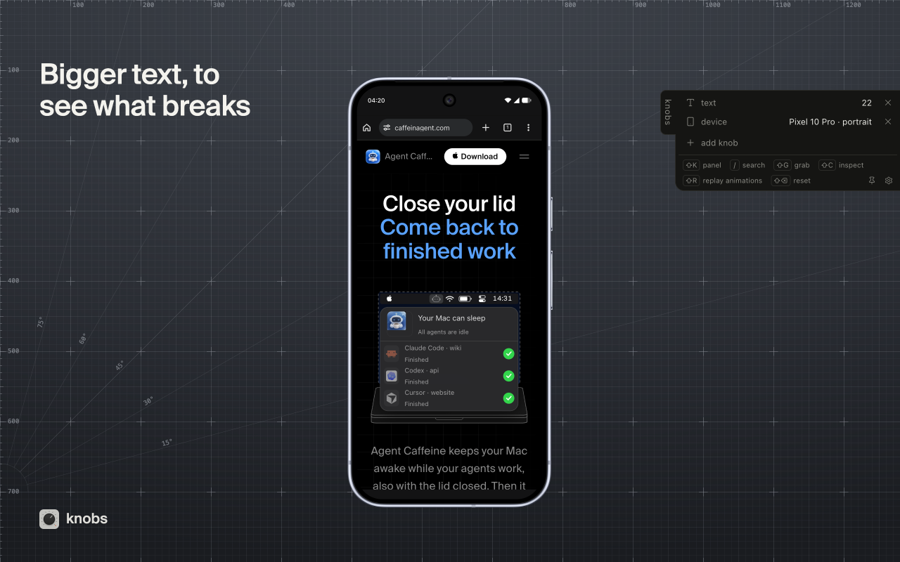
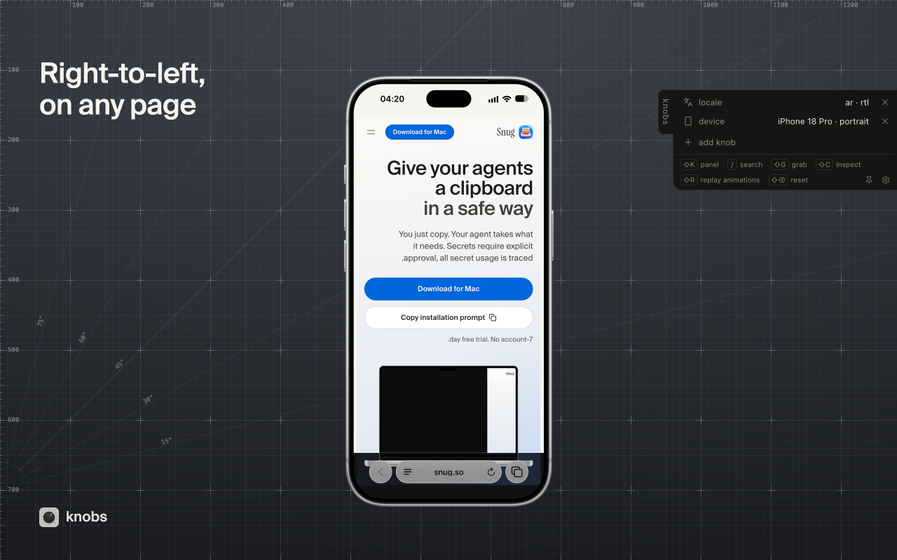
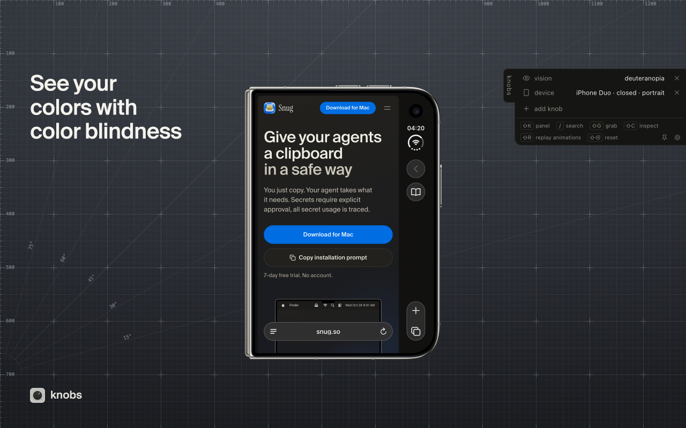
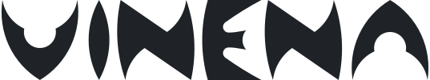

<p align="center">
  
</p>

<h1 align="center">knobs</h1>

<p align="center">See your site on an iPhone or a Pixel, tomorrow morning, in Arabic or in dark mode, from a panel inside the page</p>

<p align="center">
  <a href="https://chromewebstore.google.com/detail/knobs/cpdmafeojnbdnnhldafobkaajiemcidj">Add to Chrome</a> ·
  <a href="https://knobs.dev">knobs.dev</a> ·
  <a href="https://knobs.dev/docs/start">docs</a> ·
  <a href="https://www.npmjs.com/package/@vinena/knobs">npm</a>
</p>

knobs is a free, open source panel for web developers and designers. Open any page and test how it looks in dark mode, on a phone, with reduced motion, with larger text, in another language or in another time zone. You do not change your system settings or your code.

## Install

### Chrome extension

1. [Add knobs to Chrome](https://chromewebstore.google.com/detail/knobs/cpdmafeojnbdnnhldafobkaajiemcidj).
2. Open the page you are building, also on localhost.
3. Click the knobs icon and set a knob. The page changes at once.

### npm package

The same panel ships as the npm package @vinena/knobs. Add it to your own app in development, and the panel opens there for your whole team, with no extension.

```sh
npm i -D @vinena/knobs
```

```js
import { mount } from '@vinena/knobs';

if (import.meta.env.DEV) mount();
```

Press `⇧K`, or click the handle on the right edge of the window, to open the panel. React, Next.js and the early script are in the [docs](https://knobs.dev/docs/start).

### With a coding agent

Paste this setup prompt into Claude Code, Codex or Cursor, and it installs @vinena/knobs and mounts it in development only. It is the copy installation prompt button on https://knobs.dev too.

<details>
<summary>Installation prompt</summary>

```
Read https://knobs.dev/llms-full.txt first: it is the full knobs reference. Then install @vinena/knobs in this project. It is a dev-only panel that emulates browser preferences from inside the page.

1. Detect the package manager from the lockfile and add @vinena/knobs as a dev dependency (npm i -D @vinena/knobs, or the pnpm, yarn or bun equivalent).
2. Mount it once, on the client, in development only:
- Next.js: make a small client component (the file starts with "use client"). In it, import dynamic from "next/dynamic", then const Knobs = process.env.NODE_ENV === "development" ? dynamic(() => import("@vinena/knobs/react").then((m) => m.Knobs), { ssr: false }) : null; and render {Knobs && <Knobs />}. Render that component once in app/layout (App Router) or pages/_app (Pages Router).
- Everything else with a bundler (Vite, TanStack Start, React Router, SvelteKit): call if (import.meta.env.DEV) import("@vinena/knobs").then(({ mount }) => mount()); in the client entry, or in a mount effect of the root component in an SSR app. Use the bundler's own dev flag where import.meta.env.DEV does not exist.
- A plain page with no bundler: skip the npm install and add <script src="//unpkg.com/@vinena/knobs/dist/index.global.js"></script> to the page. It mounts itself. Keep it out of the deployed page.
3. Keep knobs out of production builds. A static import stays in the bundle even behind a dev check, so gate the import itself as above. If the project has a build script, run it and check that the output has no knobs.
4. If the app reads media queries, the time or the user agent while it boots, or renders with React, add the early script as the first element in <head>, in development only: <script src="//unpkg.com/@vinena/knobs/dist/early.global.js"></script>
5. Change nothing else in the project for the setup.
6. Open the app in your browser tool, such as Playwright or the Chrome DevTools MCP, and drive window.knobs (or window.devknobs where window.knobs is not there). For each check, call window.knobs.reset(), then window.knobs.setState(), then await window.knobs.ready(). Check a phone ({ device: "iphone-17" }), dark mode ({ scheme: "dark" }) and a right-to-left language ({ locale: { lang: "ar", dir: "rtl" } }). The locale knob can reload the page, so wait for the load. window.knobs.grab() what breaks, fix it and check again. Then call window.knobs.reset().
7. Then tell me what you changed, what you fixed and how to open the panel: press Shift+K or click the handle on the right edge of the window. In the open panel, / searches the knobs. Shift+G grabs an element.
```

</details>

## What you can test

**Look and accessibility**

- Dark mode and light mode (prefers-color-scheme), per tab
- Reduced motion (prefers-reduced-motion), animation speed and replay
- Higher contrast (prefers-contrast) and reduced transparency
- Text size and text spacing
- Color blindness filters: protanopia, deuteranopia, tritanopia, achromatopsia, and blur

**Devices and responsive design**

- Any width or height, with touch, so your breakpoints really change
- Phone, tablet and laptop sizes, with a device frame drawn around the page if you want one
- A user agent switcher, so the server sees that browser

**Language, place and time**

- Any locale, with right-to-left (RTL) or left-to-right text direction
- Pseudolocalization, to find text that does not fit
- Geolocation from city presets or your own coordinates
- Time zone and the page clock: a different zone, a time offset, or a stopped clock

**Network**

- Offline, to see how the page acts with no connection

<p align="center">
  <a href="https://knobs.dev/docs/start"></a>
  <a href="https://knobs.dev/docs/start"></a>
  <a href="https://knobs.dev/docs/start"></a>
  <a href="https://knobs.dev/docs/start"></a>
</p>

## For coding agents

Grab: click an element to copy its html, the components that rendered it and their source files, ready to paste to a coding agent.

[Agents](https://knobs.dev/docs/agents): let a coding agent drive the knobs, wait for the page, grab what broke and fix it.

The full reference, every detail in one file, is at <https://knobs.dev/llms-full.txt>.

## Docs

- [Start](https://knobs.dev/docs/start): install @vinena/knobs and mount it in development only
- [The panel](https://knobs.dev/docs/panel): open it, move it, search it, pin it and set its keys
- [Knobs](https://knobs.dev/docs/knobs): every knob knobs has and what it does to the page
- [Devices](https://knobs.dev/docs/devices): phone, tablet and laptop presets, with mocks, bezels and the phone's browser drawn around the page
- [Grab and inspect](https://knobs.dev/docs/grab): grab an element for a coding agent, or inspect its box and css in the panel
- [Requests and storage](https://knobs.dev/docs/requests-and-storage): see every request the page makes, and read, edit and save what it keeps
- [Chrome extension](https://knobs.dev/docs/extension): the panel on any site, with some knobs set for real by Chrome
- [Limits and FAQ](https://knobs.dev/docs/limits): what knobs cannot fake from inside a page, and common questions
- [Privacy](https://knobs.dev/docs/privacy): what the npm package, the extension and knobs.dev keep, and what they send

## Privacy

The extension sends nothing to us or any third party, and has no analytics. Privacy policy: https://knobs.dev/docs/privacy

## Contributing

See [CONTRIBUTING.md](CONTRIBUTING.md) for the monorepo layout, the stack and the dev commands.

## License

MIT, except the bezel images in `dist/bezels`. bippy and the code adapted from react-grab are MIT too, see [THIRD_PARTY_NOTICES.md](packages/devknobs/THIRD_PARTY_NOTICES.md).

<p align="center">crafted at <a href="https://vinena.studio/?utm_source=github.com&utm_medium=referral&utm_campaign=readme"><picture><source media="(prefers-color-scheme: dark)" srcset=".github/assets/vinena-wordmark-dark.svg"><source media="(prefers-color-scheme: light)" srcset=".github/assets/vinena-wordmark-light.svg"></picture></a></p>
